# ٢. مخطط قاعدة البيانات (ERD)

```mermaid
erDiagram
    countries ||--o{ brand_agents : "has"
    countries ||--o{ evidence : "jurisdiction"
    brands ||--o{ brand_agents : "authorizes"
    brands ||--o{ products : "owns"
    products ||--o{ product_variants : "has"
    product_variants ||--o{ formula_versions : "has"
    formula_versions ||--o{ variant_ingredients : "lists"
    ingredients ||--o{ variant_ingredients : "used in"
    ingredients ||--o{ ingredient_synonyms : "known as"
    sources ||--o{ evidence : "cited by"
    sources ||--o{ regulatory_alerts : "cited by"
    sources ||--o{ formula_versions : "cited by"
    sources ||--o{ brand_agents : "cited by"
    regulatory_alerts ||--o{ alert_items : "contains"
    products ||--o{ alert_items : "concerns"
    product_variants ||--o{ reference_images : "depicts"
    method_versions ||--o{ scans : "evaluated with"
    product_variants ||--o{ scans : "resolved to"
    scans ||--o{ scan_signals : "produced"
    scans ||--o{ reports : "basis of"
    import_batches ||--o{ raw_import_rows : "contains"
    raw_import_rows |o--o| products : "imported as"
    profiles ||--o{ evidence : "verified by"
    profiles ||--o{ reference_images : "approved by"
    products ||--o{ listing_sources : "seen at (private)"
    category_map ||--o{ products : "normalizes"

    countries {
        char2 iso2 PK
        text name_ar
        text name_en
    }
    brands {
        uuid id PK
        text name
        text parent_company
        text anti_counterfeit_url
        text official_verification_method
        text report_email
        jsonb declared_security_features
        uuid source_id FK
    }
    brand_agents {
        uuid id PK
        uuid brand_id FK
        char2 country FK
        text agent_name
        text contact
        uuid source_id FK
        date verified_at
    }
    products {
        uuid id PK
        uuid brand_id FK
        text official_name
        text category "skincare|makeup|fragrance|filler|botulinum|..."
        text regulatory_class "cosmetic|medical_device|medicine"
        text verification_status "candidate_unverified|verified|retired"
        text external_ref "IQB-xxxx or pilot id"
        text category_raw "exact text from the import file"
        text official_name_witness_url "name only, not packaging"
    }
    category_map {
        text category_raw PK
        text category "normalized; set by admin, never by importer"
        text regulatory_class_hint "needs separate verification"
        uuid mapped_by FK
    }
    listing_sources {
        uuid id PK
        uuid product_id FK
        text seller_name "PRIVATE: admin-only, never shown in app"
        text listing_url "PRIVATE"
        text variants_as_listed
        text barcode_as_listed "seller claim, never a reference GTIN"
        text circulation_evidence
        date collected_at
    }
    product_variants {
        uuid id PK
        uuid product_id FK
        text market "market edition"
        text gtin "GTIN-14 normalized, nullable"
        numeric size_value
        text size_unit
        numeric concentration_value
        text concentration_unit
        text origin_country "from official source only"
        int shelf_life_min_months
        int shelf_life_max_months
        text batch_regex "nullable"
        text verification_status
    }
    formula_versions {
        uuid id PK
        uuid variant_id FK
        date valid_from
        uuid source_id FK
        date source_date
    }
    ingredients {
        uuid id PK
        text inci_name UK
        bool is_active_substance
    }
    ingredient_synonyms {
        uuid id PK
        uuid ingredient_id FK
        text synonym
        text lang
    }
    variant_ingredients {
        uuid formula_version_id FK
        uuid ingredient_id FK
        int position
        numeric declared_concentration "nullable"
    }
    sources {
        uuid id PK
        text publisher "MoH Iraq, SFDA, MoPH Lebanon, TITCK-UTS, GUBIS, manufacturer, GS1..."
        text title
        text url
        date document_date
        text archived_copy_path
        text sha256
    }
    evidence {
        uuid id PK
        text subject_type "product|variant|agent|formula|image"
        uuid subject_id
        char2 country FK "one row per country"
        text field "registration|gtin|size|concentration|..."
        text status "yes|partial|no|not_checked"
        text partial_note
        uuid source_id FK
        date document_date
        date last_verified_at
        uuid verified_by FK
    }
    regulatory_alerts {
        uuid id PK
        text authority
        date alert_date
        text channel "e.g. social_media"
        uuid source_id FK
    }
    alert_items {
        uuid id PK
        uuid alert_id FK
        uuid product_id FK
        text batch
        text alert_kind "copied_genuine_batch|fake_batch|unknown"
        date genuine_mfg_date
        date genuine_exp_date
        date counterfeit_mfg_date
        date counterfeit_exp_date
    }
    reference_images {
        uuid id PK
        uuid variant_id FK
        text storage_path
        text view "front|back|cap|batch_area"
        text acquisition "authorized_agent_sample|manufacturer_material"
        uuid source_id FK
        uuid approved_by FK
        vector embedding
    }
    method_versions {
        text version PK "v1, v1.1 ..."
        jsonb rules
        text rules_sha256
        timestamptz published_at
        uuid published_by FK
    }
    scans {
        uuid id PK
        uuid user_id "nullable, anonymous allowed"
        uuid variant_id FK "nullable"
        text verdict "match|minor|suspect|mismatch|insufficient"
        text method_version FK
        jsonb extraction "label-extraction output"
        text purchase_channel
        bool computed_offline
        timestamptz images_delete_at
        bool images_retained_with_consent
        timestamptz created_at
    }
    scan_signals {
        uuid id PK
        uuid scan_id FK
        text type
        text outcome "match|mismatch|unavailable"
        text severity "critical|major|minor|info"
        numeric weight
        numeric confidence
        bool experimental
        jsonb evidence "found / reference / source_id"
    }
    reports {
        uuid id PK
        uuid scan_id FK
        text recipients "brand|regulator"
        text channel "email|whatsapp"
        text review_status "new|reviewing|forwarded|closed"
        text seller_info_private "never shown in app"
    }
    import_batches {
        uuid id PK
        text file_name
        text sha256
        timestamptz imported_at
    }
    raw_import_rows {
        uuid id PK
        uuid batch_id FK
        text sheet
        int row_number
        jsonb cells "exact columns and values"
        uuid product_id FK
    }
    profiles {
        uuid id PK
        text role "admin|reviewer|user"
    }
```

## ملاحظات على الجداول (إضافات على القائمة في البرومبت)
| إضافة | السبب |
|---|---|
| `sources` منفصل | الرابط الواحد (مثلاً وثيقة SFDA) قد يدعم عشرات الأدلة. نحفظ نسخة مؤرشفة وبصمة SHA-256 لأن الروابط الرسمية تتغير. |
| `formula_versions` | تحديث التركيبة المشروع يُعرف بمطابقة قائمة المكونات المقروءة مع نسخة أقدم موثّقة. |
| `alert_items` | الإنذار الواحد قد يشمل عدة تشغيلات، وكل تشغيلة تحمل تواريخ الأصلي والمقلّد. هذا ما تحتاجه حالة JUVÉDERM ULTRA 4. |
| `ingredient_synonyms` | قاموس المرادفات المطلوب في ٥.٤. |
| `raw_import_rows` | يحفظ كل خلية من Excel كما هي. لا يُضاف أي حقل لا مصدر له، ويمكن تتبّع كل سجل إلى الصف الأصلي. |
| `verification_status` على `products` و`product_variants` | السجلات المستوردة من ملفات IQB تبدأ `candidate_unverified`، ولا يصدر عليها "مطابق للمرجع". |
| `scan_signals` | الإشارات قابلة للاستعلام لمراجعة أداء المنهج لاحقاً. |

## الصلاحيات (RLS)
- قراءة عامة: المراجع الموثّقة، الأدلة، الإنذارات، الوكلاء، نسخ المنهج المنشورة.
- كتابة: `admin` و`reviewer` فقط.
- `scans` و`reports`: صاحب الفحص فقط، والمشرفون للبلاغات. `seller_info_private` لا يُعرض عبر أي واجهة عامة.
- لا توجد قيمة GTIN أو صورة أو رقم تسجيل بلا `source_id`. يُفرض ذلك بقيد في القاعدة (CHECK أو trigger).

## تحديث 2026-11-09 بعد قرارات المالك وفحص الملفات
- **`listing_sources` (خاص بالمشرفين فقط):** ملفات IQB تذكر أسماء متاجر وروابط عروض. هذه أدلة على التداول فقط. لا تُعرض في التطبيق، التزاماً بقاعدة عدم ذكر البائع. "الباركود كما أورده البائع" يُحفظ هنا كادعاء، ولا يُنقل إلى `product_variants.gtin`.
- **`category_raw` و`category_map`:** الدفعتان تستخدمان تصنيفين مختلفين (6 فئات و10 فئات). المستورد يحفظ النص كما هو. تحويله إلى فئة موحدة قرار مشرف يُسجَّل باسمه، ولا يتم آلياً.
- **تركيا:** تُضاف `TR` إلى `countries`، ومصادرها: TİTCK/ÜTS (إخطار مستحضرات التجميل وتسجيل الأجهزة الطبية) وGÜBİS (المنتجات غير الآمنة) كمصدر لـ `regulatory_alerts`. ملاحظة منهجية: الإدراج في ÜTS لمستحضرات التجميل **إخطار وليس موافقة**، فيُعرض كـ "مُخطَر به في تركيا" وليس "معتمد".

### ترتيب قوة الأدلة المحدّث
1. وزارة الصحة العراقية (غير إلزامي؛ إن وُجد فله الأولوية)
2. SFDA السعودية
3. وزارة الصحة اللبنانية
4. TİTCK/ÜTS التركية (للأجهزة الطبية: تسجيل؛ لمستحضرات التجميل: إخطار)
5. الأردن والإمارات والخليج
6. نشرة الشركة وموقعها الرسمي
7. GS1 (صحة الباركود وملكية البادئة فقط)
